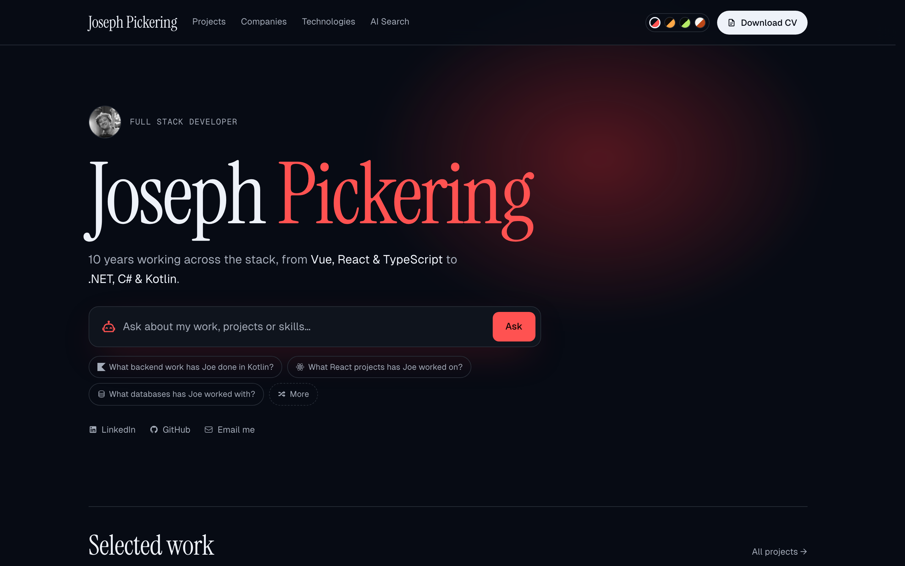
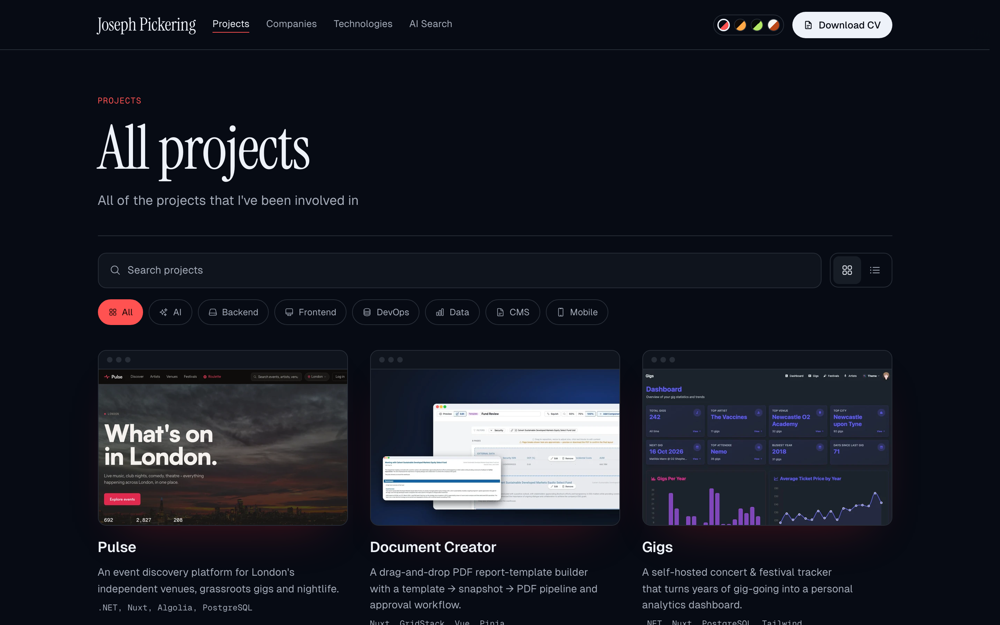
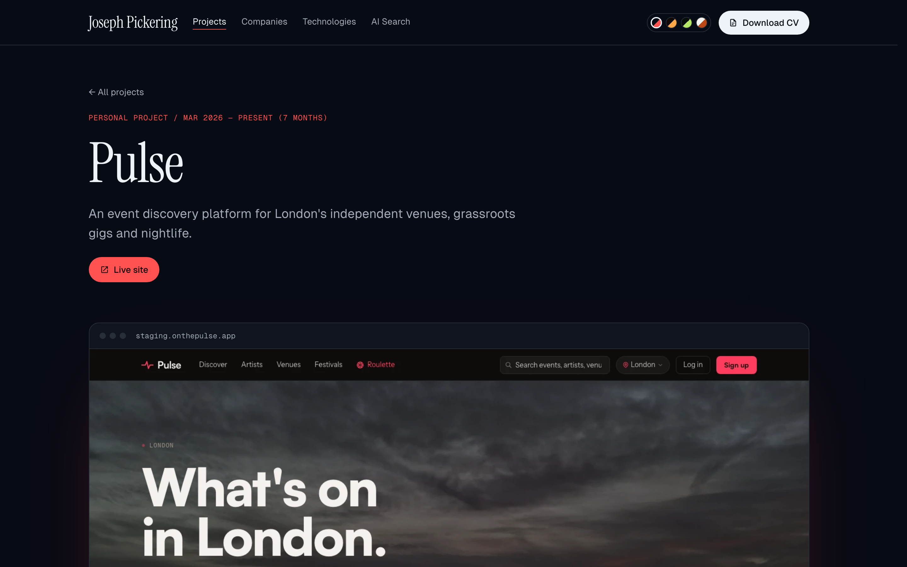
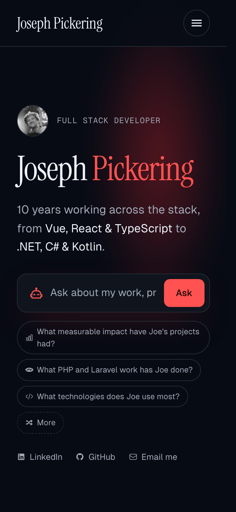
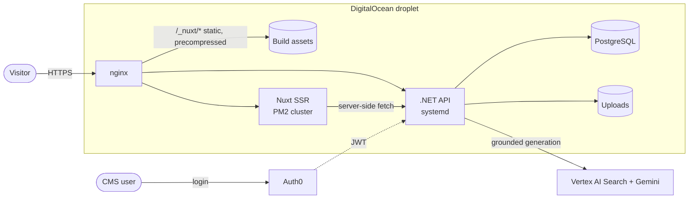

# Portfolio

[](https://github.com/josephpickering9/portfolio/actions/workflows/api.yml)
[](https://github.com/josephpickering9/portfolio/actions/workflows/web.yml)
[](https://github.com/josephpickering9/portfolio/actions/workflows/codeql.yml)
[](https://github.com/josephpickering9/portfolio/actions/workflows/lighthouse.yml)
[](./LICENSE)

The source of [josephpickering.co.uk](https://josephpickering.co.uk): my portfolio, with case studies, a company
timeline, an AI search over my projects and a CMS behind it. It's also a project in its own right, so the code
is held to the same standard as the work it describes.



| Projects | Case study | Mobile |
|---|---|---|
|  |  |  |

## Stack

| | |
|---|---|
| **Frontend** ([`web/`](./web)) | Nuxt 4 (SSR), Vue 3, TypeScript, Tailwind CSS v4, Pinia, Vitest, Playwright |
| **Backend** ([`api/`](./api)) | .NET 10, ASP.NET Core, EF Core, PostgreSQL, FluentValidation, xUnit, Testcontainers |
| **AI search** | Google Vertex AI Search grounding Gemini answers in the project data |
| **Auth** | Auth0: JWT bearer on the API, SPA SDK on the CMS |
| **Infrastructure** | GitHub Actions, DigitalOcean, nginx, systemd, PM2 |

## Architecture



The frontend's API client is **generated** from the backend's Swagger spec (`yarn codegen`), so a backend change
shows up as a TypeScript error in whatever consumes it. CI regenerates it and fails if the committed client has drifted.

## Engineering highlights

Places worth reading if you're reviewing the code:

- **One error contract across both sides.** Every API failure is `{ "error": "<code>" }`. The codes live in
  [`ErrorCodes.cs`](api/Portfolio.Api/Types/ErrorCodes.cs) and [`errors.ts`](web/app/types/errors.ts), and
  [`errors-contract.spec.ts`](web/tests/types/errors-contract.spec.ts) parses the C# file so the build fails if
  they drift.
- **`Result<T>` instead of exceptions** for expected failures, so controllers are one expression with no branching
  ([`ResultExtensions.cs`](api/Portfolio.Api/Extensions/ResultExtensions.cs)).
- **Architecture enforced by tests.** [`ArchitectureTests.cs`](api/Portfolio.Api.Tests/Architecture/ArchitectureTests.cs)
  fails the build if a controller reaches a repository or a concrete class isn't `sealed`.
- **Tests against real PostgreSQL.** Testcontainers migrates a template database once and clones it per test
  ([`TestDatabase.cs`](api/Portfolio.Api.Tests/Fixtures/TestDatabase.cs)). On its first run it caught
  tests seeding duplicate slugs that an in-memory provider had let through. Integration tests sign their own JWTs, so the suite needs no secrets or network.
- **E2E against a production build.** Playwright runs against `nuxt build` output and a real API on a
  [seeded database](web/e2e/fixtures/seed.sql), including [axe-core WCAG 2.2 AA checks](web/e2e/accessibility.spec.ts)
  on every public page and [CSP, caching and structured-data assertions](web/e2e/seo-and-security.spec.ts).
- **A strict CSP that works with SSR.** Per-request nonces with `'strict-dynamic'`, SRI on every script, and the one
  inline handler `@nuxt/image` emits allowed by exact hash rather than `'unsafe-inline'` ([`nuxt.config.ts`](web/nuxt.config.ts)).
- **Deploys gated on tests, with rollback.** Both pipelines deploy only after unit, integration and E2E tests pass.
  The release scripts ([API](api/deploy/activate.sh), [web](web/deploy/activate.sh)) health-check the new release and
  roll back to the previous one if it never comes up. Every action is pinned to a commit SHA.
- **Lean list responses.** Lists return a `ProjectSummary` DTO rather than full entities, which took the homepage's
  server-rendered HTML from 227 KB to 76 KB.
- **The Auth0 SDK is only downloaded when needed:** for the CMS, a returning signed-in visitor, or the login
  callback ([`auth0.client.ts`](web/app/plugins/auth0.client.ts)).

The reasoning behind the bigger choices is written up as [architecture decision records](docs/adr).

## Quick start

```bash
./dev.sh                       # API + frontend together, Ctrl+C stops both
./dev.sh --docker --migrate    # also start Postgres and apply migrations first
./dev.sh --codegen             # regenerate the API client once the API is up
```

Or run each side manually:

```bash
# 1. Backend: Postgres, migrations, API
docker-compose -f "api/Portfolio.Api/docker-compose.yml" up -d
dotnet ef database update --project api/Portfolio.Api
dotnet run --project api/Portfolio.Api   # http://localhost:5105, Swagger at /swagger

# 2. Frontend, in a second terminal
cd web
yarn install
yarn codegen   # regenerate the API client against the running backend
yarn dev
```

Each project needs its own `.env`; see `api/Portfolio.Api/.env.example` and `web/.env.example`.

## Tests

```bash
cd api && dotnet test             # unit, integration and architecture tests (needs Docker)
cd web && yarn test:coverage      # unit tests with coverage
cd web && yarn test:e2e           # Playwright against a production build (needs the API running)
```

## Repository layout

| Path | What's there |
|---|---|
| [`api/`](./api) | The .NET API and its tests. [README](./api/README.md) · [conventions](./api/CLAUDE.md) |
| [`web/`](./web) | The Nuxt frontend and its tests. [README](./web/README.md) · [conventions](./web/CLAUDE.md) · [design system](./web/DESIGN.md) |
| [`docs/adr/`](./docs/adr) | Architecture decision records |
| [`docs/deploy/`](./docs/deploy/README.md) | How releases are activated, rolled back and served |
| [`docs/CODE_QUALITY_BACKLOG.md`](./docs/CODE_QUALITY_BACKLOG.md) | What's been audited, fixed and deliberately left alone |

The `CLAUDE.md` files hold each project's standing conventions. They're written so they work as instructions for
an AI coding agent as well as for people.

## Licence

The code is [MIT licensed](./LICENSE). My CV, photos, and the project write-ups and screenshots the site displays
are not covered by it. See [NOTICE](./NOTICE).
